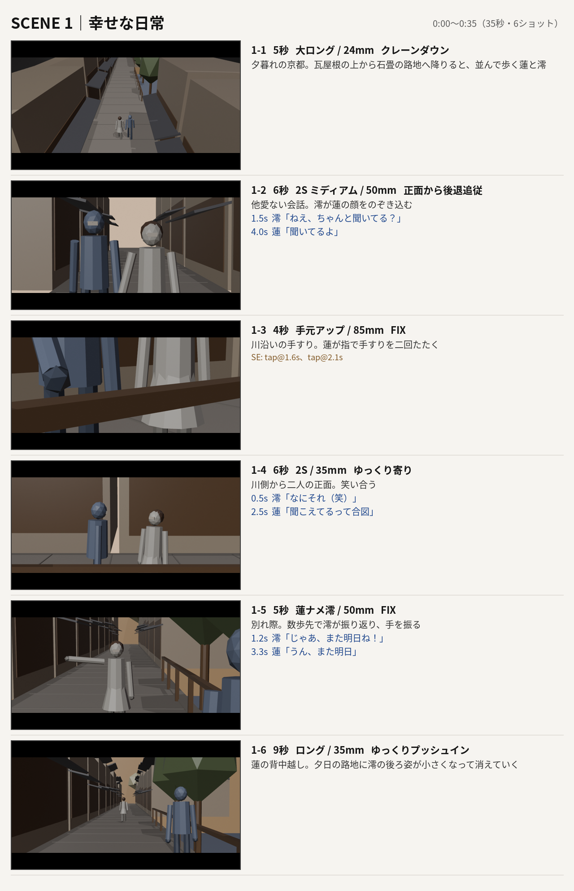
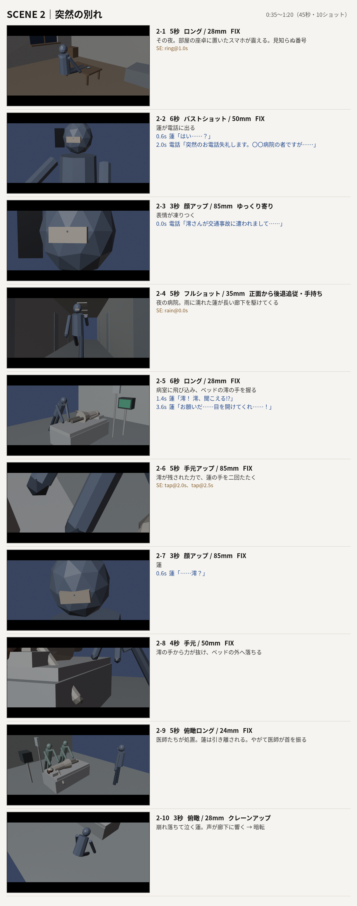
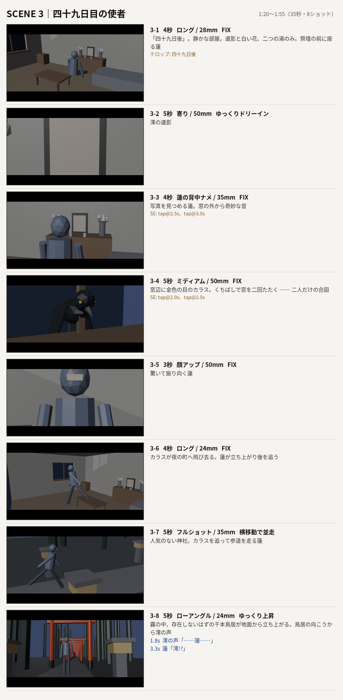
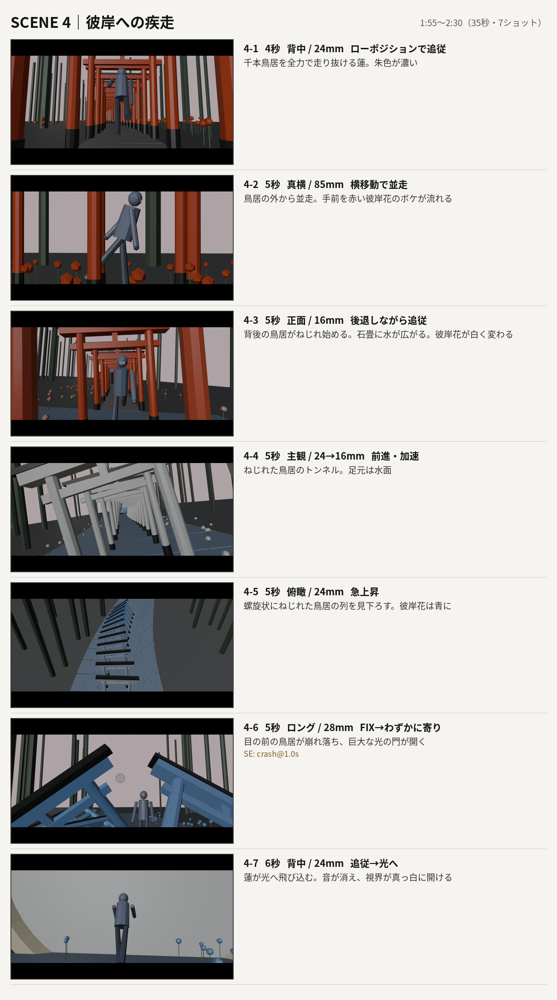
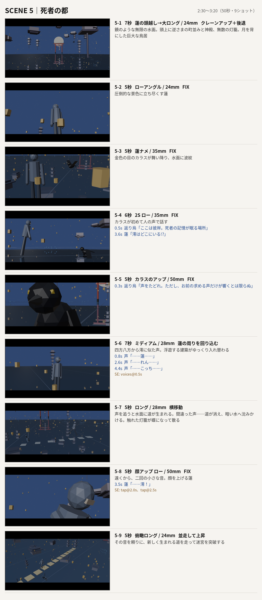
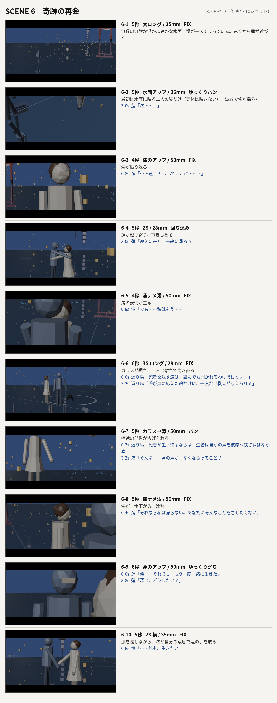
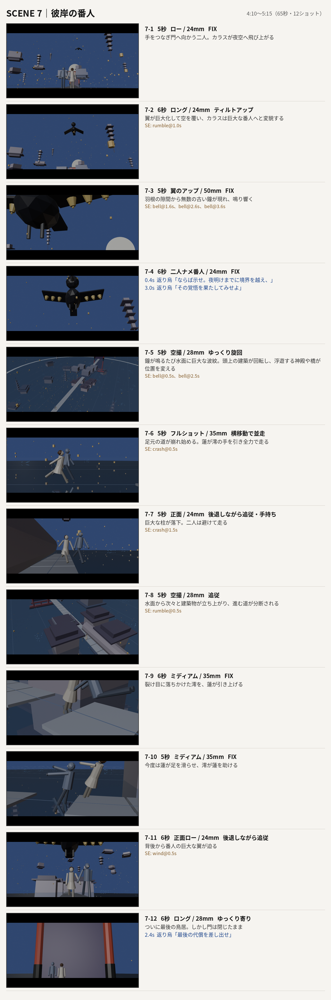
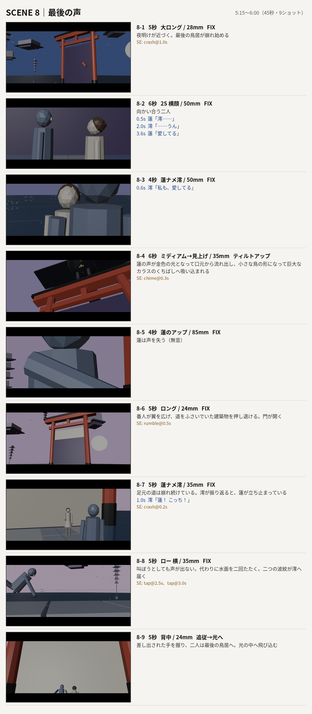
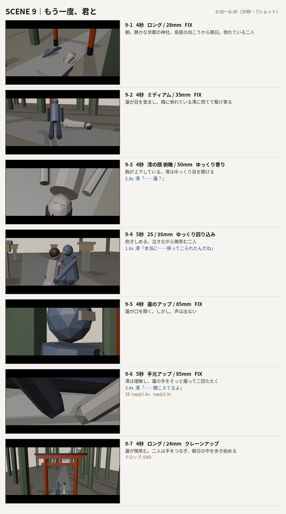

# 『返り音』絵コンテ（プリビズ版）

脚本 v1.0 をもとに、Blender のプリビズから各ショットの中間フレームを切り出したもの。
グレーのマネキン・簡易セットによる構図とカメラワークの確認用です。

## SCENE 1｜幸せな日常（0:00〜0:35）

## SCENE 2｜突然の別れ（0:35〜1:20）

## SCENE 3｜四十九日目の使者（1:20〜1:55）

## SCENE 4｜彼岸への疾走（1:55〜2:30）

## SCENE 5｜死者の都（2:30〜3:20）

## SCENE 6｜奇跡の再会（3:20〜4:10）

## SCENE 7｜彼岸の番人（4:10〜5:15）

## SCENE 8｜最後の声（5:15〜6:00）

## SCENE 9｜もう一度、君と（6:00〜6:30）

合計 6:30
